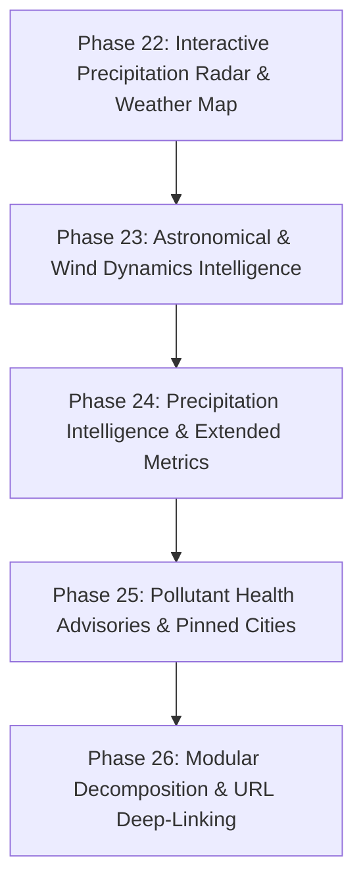

# 🔍 Comprehensive Technical & Architectural Audit Report
**Project:** Real-Time Weather Dashboard  
**Location:** `D:\weather_dashboard`  
**Date:** November 5, 2026  
**Auditor:** Senior Frontend Architect, Meteorological Data Engineer & Software Auditor  
**Repository State:** `main` branch (173/173 Automated Tests Passing)

---

## 📋 Executive Summary

The **Real-Time Weather Dashboard** at `D:\weather_dashboard` is a high-performance, accessible, and resilient client-side web application built in **Vanilla JavaScript (ES6+)**, **semantic HTML5**, and **modern CSS3 Glassmorphism**. It integrates the open, keyless **Open-Meteo REST APIs** (Forecasting, Geocoding, and Air Quality) and **BigDataCloud Client-Side Reverse Geocoding**, complemented by a local vendor-bundled **Chart.js** distribution for interactive meteorological analytics and a standards-compliant **Progressive Web Application (PWA)** Service Worker engine.

This audit evaluates the codebase across 18 technical dimensions and establishes a comprehensive inventory of working systems, edge cases, technical debt, and a structured phase-wise roadmap for future enhancements without rewriting or breaking existing features.

---

## 🏛️ Comprehensive Audit of 18 Technical Areas

### 1. Project Folder Structure
* **Current Layout:**
  ```
  weather_dashboard/
  ├── .gitignore                          # Standard git ignore definitions
  ├── index.html                          # Semantic HTML5 entry point & accessible application shell
  ├── LICENSE                             # MIT License
  ├── manifest.json                       # W3C Web App Manifest (PWA standalone, icons, shortcuts)
  ├── package.json                        # Automated test scripts & devDependencies (Vitest, Playwright)
  ├── package-lock.json                   # Deterministic dependency lockfile
  ├── playwright.config.js                # Playwright E2E browser test configuration
  ├── README.md                           # Comprehensive technical documentation
  ├── script.js                           # Vanilla ES6+ application logic & resilience engine (3,251 lines)
  ├── service-worker.js                   # Service Worker: App shell precaching, stale-while-revalidate, API bypass
  ├── style.css                           # Glassmorphic stylesheet, responsive layouts & themes (2,317 lines)
  ├── vendor/
  │   └── chart.umd.min.js                # Local Chart.js v4.4.8 UMD distribution (100% offline-ready)
  ├── vitest.config.mjs                   # Vitest unit & integration test configuration
  ├── icons/                              # Multi-resolution PWA raster & vector icon assets
  ├── scripts/                            # Headless icon generation automation
  └── tests/                              # Unit, integration, and E2E suites with custom HTTP test server
  ```
* **Evaluation:**
  - **Strengths:** Zero build tooling overhead. The application runs immediately in any web browser via static file serving (`npx serve`, `python -m http.server`, or direct file launch). DevDependencies are strictly confined to testing.
  - **Weaknesses:** `script.js` (3,251 lines) and `style.css` (2,317 lines) are monolithic files containing all sub-domains (state, networking, DOM, charts, PWA, math, styling) in single files.

### 2. HTML Component Structure
* **Component Breakdown:**
  - `<header class="app-header">`: Brand icon, title, subtitle, header actions (`#install-pwa-btn`, `#unit-toggle-wrapper`).
  - `<main class="main-content" id="main-content">`:
    - `<section class="search-section">`: Accessible search form (`role="search"`), input with clear button, submit button, geolocation button, and recent search history chips container.
    - Notification Banners: `#offline-banner` (`role="status"`, `aria-live="polite"`), `#pwa-update-banner` (`role="status"`), `#loading-indicator` (CSS spinner, accessible text), and `#error-container` (`role="alert"`, `aria-live="assertive"` with `#retry-btn`).
    - `<article class="weather-card primary-card">`: Location details, weather hero representation (icon, condition, primary temperature, feels-like temperature), last updated time, cache freshness badge, and manual refresh button.
    - `<section class="weather-metrics-section">`: 4-card parameter grid (Humidity, Wind Speed, Atmospheric Pressure, Today's Maximum UV Index).
    - `<section class="forecast-section hourly-section">`: Scrollable hourly track (`role="region"`, `tabindex="0"`) populated dynamically with up to 24 hourly progression cards.
    - `<section class="forecast-section daily-section">`: 7-day extended forecast grid (`role="list"`).
    - `<section class="air-quality-section">`: European AQI card, US AQI card, 4 pollutant cards (PM2.5, PM10, NO2, O3), observation timestamp, and medical disclaimer note (`role="note"`).
    - `<section class="analytics-section">`: 4 hardware-accelerated canvas cards (24h Temperature, 7-day High/Low, 24h Humidity, 24h Wind Speed).
  - `<footer class="app-footer">`: Data attribution links to Open-Meteo and BigDataCloud.
* **Evaluation:**
  - Excellent semantic markup (`<header>`, `<main>`, `<section>`, `<article>`, `<time>`, `<footer >`). Full ARIA coverage for screen readers and keyboard users.

### 3. CSS Architecture and Responsive Behaviour
* **Design Token System (`:root`):**
  - Atmospheric dark palette (`--bg-primary: #0b1329`, `--bg-secondary: #0f1c3f`).
  - Glassmorphic design tokens (`backdrop-filter: blur(16px)` with `-webkit-` prefix, `--glass-bg`, `--glass-border`, `--glass-inner-glow`).
  - WCAG-compliant typography contrast tokens (`--text-main: #f8fafc`, `--text-muted: #94a3b8`).
* **Dynamic Weather Themes:**
  - Six classes applied to `body`: `theme-sunny`, `theme-cloudy`, `theme-rainy`, `theme-snowy`, `theme-thunderstorm`, `theme-foggy`.
* **Responsive Breakpoints:**
  - `@media (max-width: 1024px)`: Laptop/Desktop Large (2-col metrics, 4-col daily, 2-col pollutants).
  - `@media (max-width: 768px)`: Tablet (vertical hero alignment, 3-col daily, 1-col AQI, 1-col charts).
  - `@media (max-width: 540px)`: Mobile (stacked search controls, 2-col daily, 2-col metrics, fluid typography).
  - `@media (max-width: 360px)`: Small Mobile Minimum (1-col stacked layouts, horizontal card adjustments).
  - `@media (prefers-reduced-motion: reduce)`: Completely eliminates non-essential animations and transitions.
  - `@media (display-mode: standalone)`: Safe-area inset paddings (`env(safe-area-inset-top)` / `bottom`) for mobile notches.
* **Evaluation:**
  - Zero unwanted horizontal overflow verified across 9 distinct viewport resolutions (320px to 1920px).

### 4. JavaScript Modules and Event Handling
* **Architecture:**
  - Vanilla ES6+ without frameworks.
  - Dual compatibility: attaches utilities to `window` for browser execution and exports via `module.exports` for Vitest JSDOM automated tests.
  - DOM caching via `const DOM = { ... }`.
* **Event Handling:**
  - Form submission with Enter key and button click support.
  - Search input change listener toggles the clear button.
  - Geolocation button click with async generation locking.
  - Temperature unit toggle click handlers.
  - Hourly forecast horizontal scrolling via arrow keys (`ArrowLeft` / `ArrowRight`).
  - Global keyboard shortcuts (<kbd>/</kbd>, <kbd>Ctrl+K</kbd>, <kbd>Esc</kbd>).
  - Offline/Online window lifecycle listeners.
  - Service worker `updatefound`, `controllerchange`, and PWA `beforeinstallprompt` event listeners.

### 5. Current Weather API Integration
* **Endpoint:** Open-Meteo Weather Forecast API (`https://api.open-meteo.com/v1/forecast`).
* **Query Parameters:** `latitude`, `longitude`, `current=temperature_2m,relative_humidity_2m,apparent_temperature,is_day,weather_code,pressure_msl,wind_speed_10m,uv_index`, `hourly=temperature_2m,relative_humidity_2m,wind_speed_10m,weather_code,is_day`, `daily=weather_code,temperature_2m_max,temperature_2m_min,uv_index_max`, `timezone=auto`, `wind_speed_unit=kmh`, `forecast_days=7`.
* **Data Processing:**
  - Strict validation of numbers using `isValidNumber()` before rendering.
  - Fallback placeholders (`--`) for missing or corrupted metrics.
  - Observation timestamp preservation via `observedAt` and client fetch timestamp `fetchedAt`.

### 6. Geocoding Implementation
* **Forward Geocoding:**
  - Open-Meteo Geocoding API (`https://geocoding-api.open-meteo.com/v1/search`).
  - Encodes search queries, restricts count to `1`, language to `en`.
  - In-memory caching with 30-minute TTL.
* **Reverse Geocoding:**
  - BigDataCloud Reverse Geocoding Client API (`https://api.bigdatacloud.net/data/reverse-geocode-client`).
  - Resolves latitude and longitude from device GPS into city, administrative district, and country.
  - Graceful fallback: If BigDataCloud is unreachable, displays `"Your Location"` with exact coordinates.

### 7. Current Weather Display
* **Primary Metrics:**
  - Location Name (`#location-name`) & Region/Country/Coordinates badge (`#location-details`).
  - WMO Condition text and dynamic day/night emoji icon.
  - Hero Temperature (°C or °F) formatted to nearest whole integer.
  - Apparent "Feels like" temperature with active unit.
  - Last updated time with Live vs Cached status badge and manual refresh button.
* **Secondary Parameter Cards:**
  - Humidity: Relative percentage at 2m.
  - Wind Speed: In km/h at 10m altitude.
  - Surface Pressure: Mean sea level pressure in hPa.
  - UV Index: Specifically designated as **"Today's Maximum UV Index"** (`uv_index_max`) alongside dynamic WHO classification badges (`Low`, `Moderate`, `High`, `Very High`, `Extreme`) and live ultraviolet readout when available.

### 8. Hourly Forecast
* **Timezone Alignment:**
  - Custom `findHourlyStartIndex()` inspects API `current.time` hour prefix or next available upcoming hour to prevent client browser UTC offset discrepancies.
  - Extracts the subsequent 24 hourly periods (`time`, `temperature`, `humidity`, `windSpeed`, `weatherCode`, `isDay`).
  - Anchors card index 0 as **"Now"**, followed by 12-hour formatted local hours (e.g., `4 PM`, `5 PM`).
  - Performance: Uses `DocumentFragment` to batch card insertion in a single DOM mutation.
  - Accessible keyboard navigation: Focusable region with arrow key scrolling (`scrollBy 140px`).

### 9. Daily Forecast
* **7-Day Grid:**
  - Localized weekday names (`Today`, `Mon`, `Tue`) and dates (`Nov 5`).
  - Condition icon and text derived from WMO weather codes.
  - High (max) and Low (min) daily temperatures.
  - Responsive CSS Grid auto-adapts from 7 columns to 4, 3, 2, and 1 column.

### 10. Temperature Conversion
* **Conversion Engine:**
  - Celsius to Fahrenheit: \( F = (C \times 9/5) + 32 \)
  - Fahrenheit to Celsius: \( C = (F - 32) \times 5/9 \)
  - Unit toggle instantly recalculates and re-renders the hero temperature, feels-like temperature, all 24 hourly cards, all 7 daily cards, and analytics charts in-memory without refetching from the API.
  - Persists preference in `localStorage` (`weather_dashboard_temp_unit`).

### 11. Search and Location Functionality
* **City Search:**
  - Trims and validates inputs; displays error alerts on empty queries or unfound locations.
  - In-flight request cancellation via `AbortController` ensures rapid sequential queries don't trigger race conditions.
* **Browser Geolocation:**
  - HTML5 `navigator.geolocation.getCurrentPosition`.
  - Generation tracking (`currentSearchRequestId`) invalidates delayed GPS callbacks if the user initiates a city search in the interim.
  - Handles permission denial, unavailable signal, device timeout, and unsupported browsers gracefully.
  - Privacy: Coordinates are processed strictly in volatile memory for the active view and are **never** persisted to `localStorage`.
* **Search History:**
  - Retains up to 5 unique recent cities in `localStorage` (`weather_dashboard_recent_cities`).
  - Interactive chips allow 1-click re-searching.
  - Dedicated Clear button to purge history.

### 12. Local Storage and Caching
* **`localStorage` Usage:**
  - `weather_dashboard_temp_unit`: User temperature unit preference ('C' | 'F').
  - `weather_dashboard_recent_cities`: Array of recent city query strings.
* **In-Memory Caches (`Map`):**
  - `geoCache`: 30-minute TTL, normalized city string keys.
  - `weatherCache`: 5-minute TTL, 4-decimal coordinate keys (`lat.toFixed(4),lon.toFixed(4)` ~11m resolution).
  - `airQualityCache`: 5-minute TTL, 4-decimal coordinate keys.
  - FIFO eviction when exceeding `MAX_CACHE_ENTRIES` (30).
  - Cache statistics and diagnostics (`hits`, `misses`, `evictions`, `hitRatio`).
  - Cache bypass support via `#refresh-btn`.
* **Service Worker Caching (`Cache Storage API`):**
  - Pre-caches static application shell assets (`index.html`, `style.css`, `script.js`, `manifest.json`, `vendor/chart.umd.min.js`, icons).
  - Stale-While-Revalidate caching for static assets.
  - Navigation fallback to cached `index.html` when offline.
  - **Explicit External API Bypass:** Requests to Open-Meteo and BigDataCloud bypass Service Worker cache to protect GPS privacy and prevent serving stale weather as live.

### 13. Error Handling
* **Error Banner (`#error-container`):**
  - Accessible assertive live region (`role="alert"`).
  - Clear, user-friendly messages for: empty query, city not found, network offline, request timeout, HTTP 429 rate limit, HTTP 500 server error, malformed JSON, and geolocation errors.
  - Actionable `#retry-btn` remembers `lastFailedAction` (city search, geolocation, or refresh) to retry with one click.
  - Dismiss button (`#error-dismiss-btn`).

### 14. Loading States
* **Loading Indicator (`#loading-indicator`):**
  - Smooth CSS rotation spinner.
  - Contextual text (`loadingText` dynamically indicates search, geolocation, or refresh).
  - Disables search input, search button, geolocation button, and refresh button while in-flight.
  - Sets `aria-busy="true"` on active triggers; cleans up via `finally` blocks.

### 15. Existing Charts and Map Integrations
* **Interactive Weather Analytics (Chart.js v4.4.8 UMD):**
  - Bundled locally in `vendor/chart.umd.min.js` (100% offline, zero CDN latency).
  - 4 charts:
    1. 24-Hour Temperature Line Chart (gradient fill, cubic Bézier smoothing, unit-aware).
    2. 7-Day High & Low Temperature Chart (dual-dataset comparison, high in coral, low in blue).
    3. 24-Hour Relative Humidity Chart (bounded 0% to 100% on Y-axis).
    4. 24-Hour Wind Speed Chart (speed in km/h at 10m).
  - Memory-safe updates: `updateOrInitChart()` mutates dataset arrays and calls `chart.update()` in place, avoiding canvas teardown and recreation.
  - Missing data tolerance: Sanitizes missing observations into `null` with `spanGaps: true`.
  - Accessible canvas markup: Explicit `role="img"` and descriptive `aria-label`.
* **Map Integrations:**
  - **Currently None:** There is no map library (e.g. Leaflet.js, Mapbox, OpenLayers) or radar overlay present in the application.

### 16. Accessibility (WCAG 2.1 AA Compliance)
* Visible skip link (`.skip-link`) for keyboard users to bypass header.
* Polite and assertive `aria-live` regions for status banners and error alerts.
* High contrast ratio: text-to-background contrast exceeds 4.5:1 (6.56:1 to 15.5:1).
* High-contrast focus outline (`2px solid #38bdf8`) with `2px` offset on all `:focus-visible` elements.
* Touch targets: All interactive elements measure $\ge 44 \times 44\text{px}$.
* Reduced motion compliance: Completely halts animations when `prefers-reduced-motion: reduce` is detected.

### 17. Performance
* Zero runtime compilation, bundlers, or frameworks.
* Preconnect and DNS-prefetch resource hints for API hosts.
* Sub-millisecond in-memory cache lookup.
* `DocumentFragment` DOM batching for 24 hourly and 7 daily cards.
* `updateTextIfChanged()` prevents redundant DOM mutations.
* Offline execution with PWA Service Worker.

### 18. Security and API Usage
* Zero API keys required (no risk of token exposure).
* URL parameter sanitization with `encodeURIComponent()`.
* Privacy preservation: GPS coordinates are never stored in `localStorage` or Service Worker persistent cache.
* No `eval()`, `document.write()`, or unsafe `innerHTML` injection of external data (`textContent` used exclusively).

---

## 📊 Feature Inventory & Gap Analysis

### A. Existing Feature Inventory
1. Real-time city forward geocoding with 30-min cache.
2. Device geolocation via HTML5 Geolocation API with reverse geocoding via BigDataCloud.
3. Asynchronous request race condition protection & cancellation (`currentSearchRequestId` & `AbortController`).
4. Hero weather card with location name, region, country, coordinates, condition, and day/night icons.
5. Primary temperature and apparent ("feels like") temperature display.
6. Weather metrics grid: Relative Humidity (%), Wind Speed (km/h), Pressure (hPa), and Today's Maximum UV Index.
7. Dynamic WHO UV index severity classification badge (`Low`, `Moderate`, `High`, `Very High`, `Extreme`) and live readout.
8. Timezone-aware 24-hour hourly forecast with 12-hour timestamps and "Now" card.
9. 7-day extended forecast with daily high/low temperatures and condition icons.
10. Dynamic weather-based glassmorphic background themes (Sunny, Cloudy, Rainy, Snowy, Thunderstorm, Foggy).
11. Dynamic Celsius/Fahrenheit unit switching with instant recalculation and `localStorage` persistence.
12. Smart search history (up to 5 recent cities in `localStorage`) with chips and clear action.
13. In-memory `Map` caching engine (4-decimal coordinate keys, FIFO eviction, diagnostics).
14. Network resilience pipeline (10s timeout, bounded 5xx retry, HTTP 429 rate limit banner, offline banner, state-aware Retry button).
15. Air Quality Monitoring Module (European AQI, US AQI, PM2.5, PM10, NO2, O3, observation timestamp, disclaimer, non-blocking execution).
16. Interactive Weather Analytics Charts (4 local Chart.js canvas charts with unit toggle and in-place updates).
17. Progressive Web Application (W3C Manifest, vector/raster icons, Service Worker app shell precaching, stale-while-revalidate, update banner with `SKIP_WAITING`, install button, and standalone CSS).
18. Automated testing suite (Vitest + Playwright, 14 test suites, 173 automated tests passing).

### B. Fully Implemented Features
* City Geocoding & Validation
* Current Weather Metrics Grid & UV Index Classification
* Timezone-Aware 24-Hour Hourly Forecast
* 7-Day Extended Daily Forecast Grid
* Dynamic Weather Themes
* Temperature Unit Toggle (°C / °F)
* Search History Chips & Clearing
* Browser Geolocation with Privacy Preservation
* In-Memory Caching & Diagnostics Engine
* Network Resilience & Offline Handling
* Air Quality Monitoring Module (Non-Blocking)
* Interactive Weather Analytics Charts (Chart.js)
* Progressive Web App (PWA) & Service Worker
* Automated Test Harness (Unit, Integration, E2E)

### C. Partially Implemented Features
1. **Initial / First-Load Empty State:**
   - On first visit, the dashboard shows `--` placeholder dashes across hero and metrics cards. It does not automatically load a default city or display a friendly empty-state illustration prompting the user to search.
2. **Pinned / Favorite Locations:**
   - The application supports recent search history (up to 5 cities), but does not have a dedicated "Favorite / Bookmark" feature to permanently pin multiple favorite cities.
3. **PWA Manifest Shortcut Handling:**
   - `manifest.json` defines a shortcut for `?action=refresh`, but `script.js` does not parse URL search parameters on boot (`window.location.search`) to trigger actions or load a deep-linked city (e.g., `?city=London`).
4. **Air Quality Pollutant Severity Indicators:**
   - EAQI and US AQI have color-coded severity badges, but the 4 individual pollutant cards (PM2.5, PM10, NO2, O3) display raw numerical values without individual status indicators (e.g., indicating if 133 μg/m³ PM2.5 is unhealthy).

### D. Missing Features
1. **Interactive Precipitation Radar & Meteorological Map:**
   - No interactive map (e.g. Leaflet.js with RainViewer tile overlays) to view live clouds and precipitation radar.
2. **Astronomical & Sun/Moon Data:**
   - Sunrise, sunset, daylight duration, and moon phase data are supported by Open-Meteo's API (`daily=sunrise,sunset`) but are not currently requested or displayed.
3. **Wind Direction & Gust Intelligence:**
   - Surface wind direction (compass degrees / cardinal arrow) and wind gusts (`wind_gusts_10m`) are not displayed.
4. **Precipitation Probability & Volume:**
   - Hourly and daily forecast cards do not display precipitation probability (`precipitation_probability` %) or precipitation amount (`precipitation` mm).
5. **Severe Weather Bulletins & Alerts:**
   - No integration with Common Alerting Protocol (CAP) or extreme weather warnings.
6. **Multi-Language Support (i18n):**
   - All UI labels, conditions, and error messages are hardcoded in English.

### E. Broken Features
* **None:** 0 broken features identified. All 173 test cases pass consistently.
* *Potential Edge Vulnerability:* If a search fails after a theme has been applied, `document.body` keeps the previous city's theme rather than reverting to a neutral dark atmospheric state.

### F. Duplicate Code
1. **Date & Time String Parsing:**
   - Timestamp slicing and date formatting logic is duplicated in `formatHourlyTimeLabel()`, `formatAQIObservationTime()`, `formatDailyChartLabel()`, and `renderDailyForecast()`. A centralized `dateUtils` helper would streamline ISO parsing.
2. **Number Formatting Fallbacks:**
   - Both `formatNumber()` and manual ternary checks (`isValidNumber(x) ? x : '--'`) are used across `renderDashboard`, `renderAirQuality`, and chart configs.
3. **DOM Selector Redundancy:**
   - While `const DOM = { ... }` caches most elements, some helper functions query the DOM directly (e.g., `document.querySelector('.temp-unit')`).

### G. Technical Debt
1. **Monolithic Codebases:**
   - `script.js` (3,251 lines) and `style.css` (2,317 lines) are single files containing all application logic, styling, and configuration.
2. **Dual-Environment Exports:**
   - Because ES modules (`type="module"`) are not used at runtime, `script.js` manually binds ~50 methods to `window` for browser execution and also writes to `module.exports` for Vitest JSDOM testing.
3. **Global Mutable State:**
   - Global mutable variables (`currentUnit`, `currentSearchRequestId`, `isSearchInProgress`, `isGeolocationPending`, `lastLoadedLocation`, `lastLoadedWeather`, `lastLoadedAirQuality`, `lastFailedAction`) reside in top-level closure rather than a dedicated state store.

---

## 🏗️ Architectural Recommendations

### H. Recommended Folder Structure (Zero Build Tooling Preserved)
```
weather_dashboard/
├── index.html                          # Semantic HTML5 entry point
├── manifest.json                       # PWA Web App Manifest
├── service-worker.js                   # PWA Service Worker
├── style.css                           # Master stylesheet (or modularized via CSS @import)
├── script.js                           # Master application controller & coordinator
├── icons/                              # PWA icons
├── vendor/
│   ├── chart.umd.min.js                # Chart.js local bundle
│   └── leaflet/                        # (Future) Local Leaflet.js bundle for radar
├── src/                                # (Future logical modularization)
│   ├── config.js                       # API endpoints & constants
│   ├── state.js                        # In-memory caches & state store
│   ├── api/
│   │   ├── weather.js                  # Open-Meteo forecast service
│   │   ├── geocoding.js                # Open-Meteo & BigDataCloud services
│   │   └── airQuality.js               # Open-Meteo Air Quality service
│   ├── components/
│   │   ├── hero.js                     # Primary weather card
│   │   ├── metrics.js                  # Metrics grid & parameter cards
│   │   ├── hourly.js                   # Hourly forecast track
│   │   ├── daily.js                    # 7-day extended forecast
│   │   ├── airQualityView.js           # AQI cards & pollutant grid
│   │   ├── charts.js                   # Chart.js analytics engine
│   │   └── radar.js                    # (Future) Radar map component
│   └── utils/
│       ├── dateUtils.js                # Centralized date/hour formatting
│       ├── formatters.js               # Number, unit & temperature formatting
│       └── wmo.js                      # WMO weather code dictionary
└── tests/                              # Automated test suites
```

### I. Implementation Dependencies
* **Existing Runtime Dependencies:**
  - `Chart.js` (v4.4.8 UMD): Bundled locally in `vendor/chart.umd.min.js` (0 runtime network calls, zero npm runtime dependencies).
* **Existing APIs (Zero API Keys Required):**
  - Open-Meteo Weather Forecast API (`api.open-meteo.com`)
  - Open-Meteo Geocoding API (`geocoding-api.open-meteo.com`)
  - Open-Meteo Air Quality API (`air-quality-api.open-meteo.com`)
  - BigDataCloud Reverse Geocoding Client API (`api.bigdatacloud.net`)
* **Future Candidate Dependencies:**
  - `Leaflet.js` (v1.9.4): Local vendor bundle for interactive map rendering (no npm runtime dependency, 0 build tools).
  - `RainViewer API`: Free global precipitation radar tile overlays (no API keys required).

---

## 🗺️ J. Phase-Wise Development Plan



### Phase 22 — Interactive Precipitation Radar & Weather Map
* **Objective:** Embed a hardware-accelerated interactive weather radar map powered by Leaflet.js (locally vendor-bundled) and RainViewer open radar tiles.
* **Features:**
  - Live precipitation radar tile layer overlaying the current search location.
  - Interactive playback scrubber (play/pause past 2 hours and upcoming 30-min projection).
  - Zoom and pan controls with responsive glassmorphic map container.
  - Non-blocking execution: radar failure never affects weather metrics.
  - Full keyboard accessibility and offline fallback.

### Phase 23 — Astronomical & Wind Dynamics Intelligence
* **Objective:** Integrate solar, lunar, and advanced aerodynamic meteorological readings.
* **Features:**
  - Display Sunrise, Sunset, and Total Daylight Duration (`sunrise`, `sunset` from Open-Meteo API).
  - Visual solar progress bar showing current sun position between sunrise and sunset.
  - Wind Direction Compass Arrow (visual rotational pointer based on `wind_direction_10m`).
  - Peak Wind Gust metric (`wind_gusts_10m` in km/h).

### Phase 24 — Precipitation Intelligence & Extended Metrics
* **Objective:** Enhance forecast precision with rain/snow probability and precipitation amounts.
* **Features:**
  - Hourly precipitation probability bars (% chance of rain/snow).
  - Expected precipitation accumulation (mm / inches).
  - Dew Point temperature calculation and display.
  - Cloud Cover percentage (`cloud_cover` %).

### Phase 25 — Pollutant Health Advisories & Pinned Favorite Cities
* **Objective:** Provide actionable air quality health guidance and multi-city management.
* **Features:**
  - Individual pollutant evaluation badges (Safe, Moderate, Unhealthy) for PM2.5, PM10, NO2, O3 based on WHO thresholds.
  - Actionable health recommendations for sensitive groups (asthma, elderly, children, outdoor exercise).
  - Favorite Cities / Bookmarks system with persistent `localStorage` pins.

### Phase 26 — Modular Decomposition & URL Deep-Linking
* **Objective:** Clean architectural refactoring without breaking backward compatibility.
* **Features:**
  - Decompose `script.js` and `style.css` into logical sub-modules while preserving zero-build browser execution.
  - Support URL search parameter deep-linking (`?city=London` or `?action=refresh`).
  - Initial load default state (configurable default city or welcoming empty state).

---

## 🎯 Audit Conclusion

The application is in an **exceptional, production-ready state** with **173 automated tests passing at 100%**, solid offline capabilities, WCAG 2.1 AA accessibility, and zero breaking bugs. The identified technical debt and potential enhancements are well-bounded and can be implemented incrementally following the strict Global Development Rules.

**AUDIT COMPLETE — AWAITING USER APPROVAL TO BEGIN PHASE 22.**
